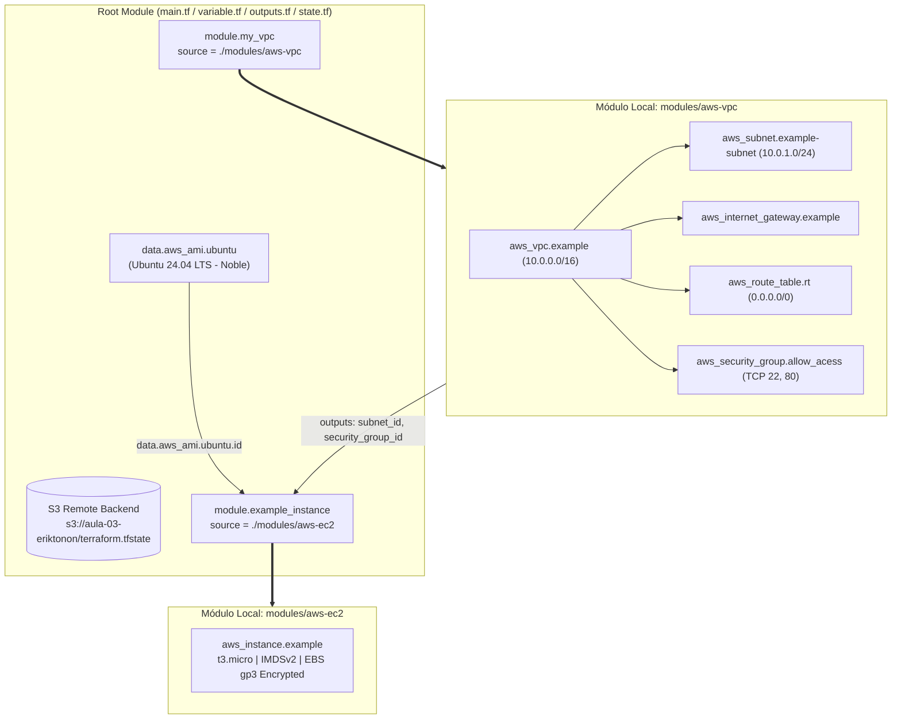

# Aula 03 — Módulos Locais Reutilizáveis no Terraform (`aws-vpc` & `aws-ec2`) e Remote State S3


-E95420?logo=ubuntu&logoColor=white)


Repositório prático da **Aula 03** da formação **Acelera DevOps & MBA Platform Engineering** (**Erik Tonon**). O foco desta aula é a **engenharia de modularização no Terraform**: como decompor configurações monolíticas em **módulos locais reutilizáveis** (`modules/aws-vpc` e `modules/aws-ec2`), conectar as saídas (`outputs`) de um módulo às entradas (`variables`) de outro e armazenar o estado remotamente no **Amazon S3 (`state.tf`)**.

---

## Arquitetura de Composição de Módulos



---

## Como Funcionam os Módulos no Terraform

Um **Módulo Terraform** é um contêiner autocontido de múltiplos recursos que são gerenciados em conjunto. Todo módulo segue o princípio de **encapsulamento**:
1. **`variables.tf` (Contrato de Entrada)**: Define quais parâmetros o módulo aceita do módulo chamador (`root`).
2. **`main.tf` (Implementação Interna)**: Declara os recursos de infraestrutura encapsulados pelo módulo.
3. **`outputs.tf` (Contrato de Saída)**: Expõe apenas os atributos necessários (como `subnet_id` e `security_group_id`) para que outros módulos possam consumi-los.

### Fluxo de Dados entre Módulos (`main.tf`)
```hcl
module "my_vpc" {
  source     = "./modules/aws-vpc"
  cidr_block = var.vpc_cidr_block
}

module "example_instance" {
  source                 = "./modules/aws-ec2"
  ami_id                 = data.aws_ami.ubuntu.id
  instance_type          = var.instance_type
  subnet_id              = module.my_vpc.subnet_id
  vpc_security_group_ids = [module.my_vpc.security_group_id]
}
```

---

## Estrutura do Repositório

```text
aula-03/
├── .github/workflows/terraform.yml  # Pipeline CI (fmt -recursive + validate)
├── main.tf                          # Composição dos módulos my_vpc e example_instance
├── variable.tf                      # Variáveis do módulo raiz (aws_region, vpc_cidr_block, instance_type)
├── outputs.tf                       # Outputs do módulo raiz (vpc_id, subnet_id, instance_id, instance_public_ip)
├── state.tf                         # Configuração de Backend Remoto no Amazon S3
├── versions.tf                      # Constraints do Terraform (>= 1.6.0) e AWS Provider (~> 5.0)
└── modules/
    ├── aws-vpc/                     # Módulo de Rede (VPC, Subnet, IGW, Route Table, Security Group)
    │   ├── main.tf
    │   ├── variables.tf
    │   ├── outputs.tf
    │   └── doc.md                   # Documentação de referência do módulo aws-vpc
    └── aws-ec2/                     # Módulo de Computação (EC2 Instance com IMDSv2 e EBS gp3)
        ├── main.tf
        ├── variables.tf
        └── outputs.tf
```

---

## Passo a Passo de Execução

### 1. Inicializar o diretório e os módulos locais
> **Dica**: Se desejar testar apenas localmente sem um bucket S3 de backend criado na sua conta, utilize `terraform init -backend=false`. Para usar o estado remoto em S3, altere o nome do bucket em `state.tf` para um bucket próprio da sua conta AWS.

```bash
terraform init
```

### 2. Verificar a formatação em todos os subdiretórios e validar
```bash
terraform fmt -check -recursive
terraform validate
```

### 3. Gerar o plano de execução e aplicar
```bash
terraform plan -out=tfplan
terraform apply tfplan
```

### 4. Destruir os recursos ao fim da aula
```bash
terraform destroy -auto-approve
```
